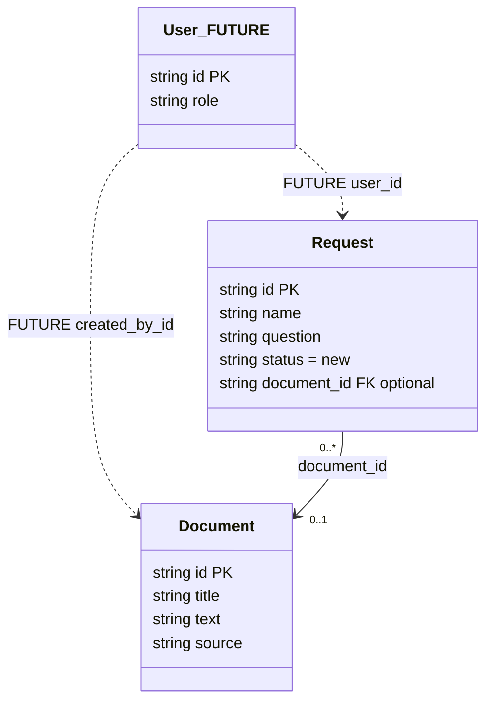
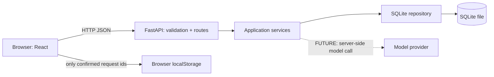
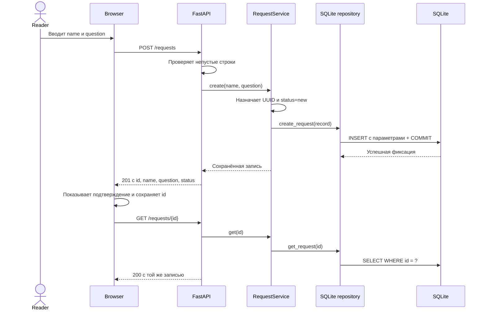

# Архитектура и контрольная точка A

Этот документ фиксирует состояние на контрольной точке A. Текущую схему входа, хранения и проверки доступа описывает [инструкция Supabase](supabase-migration.md).

Это локальное приложение для чтения документов и сохранения заявок. Основной сценарий работает без модели. Разделение слоёв позволяет менять транспорт и хранение независимо от прикладных операций; публичный запуск ещё не подготовлен.

## Границы кода

| Слой | Файлы | Ответственность |
|---|---|---|
| Домен | `backend/app/domain.py` | Неизменяемые Document и RequestRecord, ошибка отсутствующей записи. Без FastAPI, Pydantic и SQLite |
| Прикладные операции | `backend/app/services.py` | Создание UUID, начальное состояние заявки, операции чтения/изменения/удаления, NotFoundError. Зависит от протоколов хранилища |
| Хранилище | `backend/app/database.py`, `backend/app/storage/` | Подключение и транзакции отдельно от схемы SQLite и параметризованных запросов к документам, аккаунтам и заявкам |
| HTTP | `backend/app/api/`, `models.py` | Маршруты, проверка входных данных, JSON-ответы и перевод ошибок в HTTP |
| Сборка приложения | `backend/app/main.py`, `config.py` | Lifespan, CORS, обработчики ошибок, подключение маршрутов и зависимостей |
| Клиент API | `frontend/src/api/`, `config.ts` | Адрес API, fetch, response.ok, JSON-ошибки, проверка структуры успешного ответа |
| React | `frontend/src/features/` | Документы, чтение, форма, подтверждение и история заявок |
| Общие состояния | `frontend/src/hooks/useResource.ts`, `components/` | Отмена устаревших GET-запросов, loading/error/retry, общие доступные элементы |

Репозиторий SQLite не создаёт UUID и не принимает HTTP-модели. Сервисы получают хранилище через протоколы; в HTTP-зависимостях подключён SQLite, а в unit-тестах можно подставить другое хранилище. Существующие URL и JSON-поля сохранены. PATCH теперь также отклоняет неизвестные поля вместо молчаливого игнорирования.

## Роли: целевые права

Роли и пользователи пока не реализованы. Следующая таблица описывает будущую политику, а не действующую защиту.

| Действие | Читатель | Редактор | Будущая серверная проверка |
|---|---|---|---|
| Читать документы: GET /documents, GET /documents/{id} | Доступные ему документы | Доступные ему документы | Аутентификация, доступ к документу/пространству; фильтрация списка и повторная проверка отдельного GET |
| Создавать, менять и удалять документы | Нет | Да | Проверка роли, пространства и полномочий на запись в POST/PATCH/DELETE |
| Создать заявку: POST /requests | Да | Да | user_id берётся из проверенной сессии, а не из JSON браузера |
| Читать заявку: GET /requests/{id} | Только свою | Только свою, пока отдельно не утверждено право обработки чужих заявок | Проверка владельца записи на сервере при каждом чтении |

Сейчас любой клиент, имеющий доступ к локальному API, может использовать его маршруты. UUID не является проверкой доступа. История в браузере хранит только id, созданные в этом браузере, и не подтверждает личность или владение. CORS ограничивает разрешённый браузерный origin, но не заменяет аутентификацию и не блокирует обращения из curl/других программ.

## Данные и владельцы

Действие «Задать вопрос по документу» передаёт форме ID открытого документа. POST /requests принимает необязательный document_id и возвращает 404 для неизвестного документа. SQLite сохраняет связь и сбрасывает её при удалении документа. Сама заявка остаётся в истории. При запуске миграция добавляет поле к старой таблице, а прежние заявки читаются как общие.

Документ создаётся редактором через POST /documents; сейчас это можно сделать в Swagger. Заявку создаёт читатель через форму или POST /requests. В обоих случаях UUID назначает сервер. После появления User потребуется миграция: created_by_id у документа и user_id у заявки, внешние ключи, политика доступа и явное решение о владельцах старых записей. До такой миграции name остаётся обычным текстом и не идентифицирует пользователя.

## Путь данных

Создание заявки использует цепочку Browser → FastAPI → SQLite. Подготовка резюме использует отдельную цепочку Browser → `POST /ai/summary` → серверный адаптер OpenAI → проверка структуры → Browser. Эта ветка получает только текст вопроса, не обращается к SQLite и не влияет на создание заявки. Ключ провайдера находится в серверном окружении.

## Создание и чтение заявки по шагам

Во время POST кнопка заблокирована; повторная отправка также проверяется синхронным флагом. При 422 ошибки показываются рядом с полями и фокус переходит к первому проблемному полю. При сетевой ошибке значения остаются в форме, а подтверждение не появляется. При неизвестном id сервер возвращает 404; неожиданные ошибки журналируются и дают клиенту общий 500.

После перезапуска API SQLite сохраняет строки. После перезагрузки браузера история восстанавливает номера из localStorage и заново запрашивает сервер. Имя и вопрос в localStorage не копируются. Очистка браузерной истории не удаляет запись SQLite, но удаляет локальный список её номеров.

## Контрольная точка A

| Критерий | Проверка в проекте |
|---|---|
| Настоящие документы | Создать учебный документ в Swagger, нажать «Обновить», выбрать его и сверить текст/источник с GET /documents/{id} |
| Настоящая заявка | Заполнить форму, получить id и status=new, сверить все поля через GET /requests/{id} и SELECT в SQLite |
| Сохранение | Остановить API, запустить с тем же файлом базы; обновить список и историю заявки с прежним id |
| Ожидание, пустота и ошибка | Индикатор с текстом, сообщение «Документов пока нет», объяснение сетевого сбоя и рабочая кнопка повтора |
| Ошибка отправки | Остановить API, отправить заполненную форму: значения сохраняются, подтверждения нет |
| Доступность | Проверить Tab/Shift+Tab/Enter, подписи и ошибки полей, фокус и live-статус, ширины 320/390/1440px |
| Регрессии | pytest: API, транзакции, перезапуски, CORS, безопасные ошибки и прикладные сервисы; npm run build; npm run lint |
| Локальная граница | API 127.0.0.1:8000, Vite 127.0.0.1:5173; CORS только http://127.0.0.1:5173; публичных развёртываний нет |

## Оставшиеся ограничения

- Нет User, входа, сессий, ролей, владения и проверки доступа. Публичный доступ с изменением данных запрещён до их реализации.
- Управление документами пока через API/Swagger. UI редактора, поиск и пагинация не реализованы; GET /documents возвращает полный список с текстом.
- У заявки есть начальный статус `new`. В локальной истории оператор вручную меняет его на `in_progress` и `resolved`. Отправка ответа сохраняет его в ленте активности и переводит заявку в `resolved` одной транзакцией. Закрытую заявку можно возобновить. Для публичного доступа потребуется серверная проверка роли оператора и владельца заявки. Модель предлагает резюме и тип запроса для проверки человеком.
- При создании заявки ручной повтор после потери ответа сервера может создать ещё одну заявку. Повтор отправки ответа на заявку использует тот же UUID и возвращает существующую запись.
- SQLite подходит для локального этапа. Миграции схемы, нагрузочные ограничения, обработка большого объёма, управляемые резервные копии и аудит изменений ещё нужны.
- Несохранённые поля формы живут в текущей вкладке; при уходе с несохранённым вводом браузер предупреждает. Между устройствами история id не синхронизируется.
- Нет утверждённых условий использования и политики конфиденциальности для публичного сервиса. Для текущего локального этапа публичные юридические страницы не создавались.
- TypeScript не заменяет серверную валидацию: сервер проверяет входные поля, API-клиент дополнительно проверяет структуру успешных ответов.
