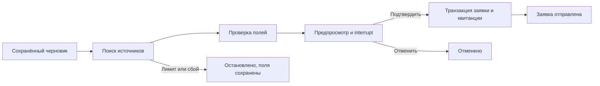

# Подтверждение заявки на консультацию

Откройте «Ответы» → «Помощник» → «Заявка на консультацию». Введите имя и вопрос и нажмите «Подготовить черновик». Сохраните адрес черновика, чтобы вернуться к нему после перезапуска. Перед отправкой можно сверить найденные фрагменты, изменить поля или отменить сценарий. При изменении сохраните новую версию и проверьте её перед подтверждением. [Запуск проекта](../README.md).



В состоянии LangGraph есть текущий пользователь, `draft_id`, версия, имя и вопрос, источники, подтверждение, `request_id` и счётчики. Сценарий сам вызывает `search_documents` и `prepare_request` через серверный список функций. Поиск использует локальный индекс. Граф ждёт явного решения после сохранения checkpoint. [LangGraph Interrupts](https://docs.langchain.com/oss/python/langgraph/interrupts).

Для каждого черновика SQLite хранит владельца, версию и статус. После `interrupt` новый запуск читает тот же checkpoint по `draft_id:version`. Файл checkpoint лежит рядом с основной базой, например `data/knowledge_desk.consultations.sqlite3`. Для копии сценариев сохраните его вместе с основной базой после остановки сервера. Отмена меняет статус в основной базе. Для ожидающего черновика сохранённая пауза остаётся в истории checkpoint, а сервер блокирует дальнейшее возобновление.

## API

| Запрос | Тело | Результат |
|---|---|---|
| `POST /consultations` | `name`, `question` | Сохранённый черновик, версия 1 |
| `POST /consultations/{id}/prepare` | `version` | Поиск и переход к проверке или причина остановки |
| `GET /consultations/{id}` | — | Текущая версия, источники и итоговый `request_id`, если он есть |
| `PATCH /consultations/{id}` | `version`, `name`, `question` | Новая версия того же черновика |
| `POST /consultations/{id}/confirm` | `version`, `name`, `question` | Отправленная заявка и `request_id` |
| `POST /consultations/{id}/cancel` | `version` | Отменённый черновик |

Сервер берёт владельца и разрешения из `ToolContext` и сравнивает поля подтверждения с сохранённой версией. Старое подтверждение или изменённые данные дают `409`, чужой черновик даёт `404`. Слова модели не проходят схему подтверждения. В приложении действует один локальный пользователь. Проверки изоляции используют разные серверные контексты. Перед многопользовательским запуском нужна авторизация и защита доступа к существующим маршрутам `/requests`.

Ключ операции формируется из `draft_id` и версии. `consultation_receipts` уникальна по паре `(user_id, operation_key)` и хранит SHA‑256 подтверждённых полей и `request_id`. Транзакция `BEGIN IMMEDIATE` проверяет версию и квитанцию, создаёт заявку и сохраняет квитанцию и статус. Повтор возвращает прежний ID. При сбое между фиксацией транзакции и сохранением следующего checkpoint повтор берёт ID из квитанции.

Та же транзакция сохраняет событие тестовой интеграции. Доставка начинается после её фиксации, а результат доставки хранится отдельно. [Настройка n8n и граница повторов](n8n-delivery.md).

## Остановки

В [конфигурации](../backend/app/config.py) заданы 8 переходов, 3 вызова инструментов и 12 секунд на один активный отрезок. Счётчики сохраняются между подготовкой и подтверждением. Во время ожидания решения сетевых запросов нет. При продолжении действует новый срок активного выполнения. У поиска и подготовки свои тайм-ауты, и граф учитывает каждую попытку. Перед следующим узлом он проверяет, не отменён ли черновик. Текущий локальный поиск может закончиться в фоне. Терминальный статус сохраняет введённые поля и причину остановки.

Если сервер остановился до `interrupt`, версию с незавершённым checkpoint можно открыть с сохранёнными полями и начать новую попытку. Граф прекращает прежний прогон, поскольку инструмент мог уже стартовать до сохранения счётчика.

Журнал содержит `draft_id`, версию и код остановки. Основные коды `step_limit`, `tool_limit`, `tool_timeout` и `active_timeout`. Экран показывает причину и действие для новой попытки. Для произвольного цикла с поиском действует предел трёх вызовов, а для цикла без инструментов предел восьми переходов.

```powershell
.\.venv\Scripts\python.exe -X utf8 -m pytest -q backend/tests/test_consultations.py
```

Тесты проверяют SQLite checkpoint, изменённую версию, отмену до записи и во время поиска, тайм-ауты, оба лимита, двойное подтверждение и повтор без ответа, две конкурентные транзакции, откат при ошибке квитанции и изоляцию пользователей. Поиск в тестах подменён фиксированными данными.

В Playwright проверены ширины 1400 и 390 px. С реальным поиском по «Орбите» подготовлена версия 2. После остановки FastAPI, паузы 13 секунд и запуска на той же тестовой SQLite версия снова ожидала подтверждения. До и после перезапуска в `requests` и `consultation_receipts` было по 0 строк. Подтверждение с клавиатуры и два параллельных повтора вернули один `request_id`. После отдельной отмены в обеих таблицах осталось по 1 строке. Состояние остановки показано в браузере подменой ответа, сам цикл проверен серверными тестами.
